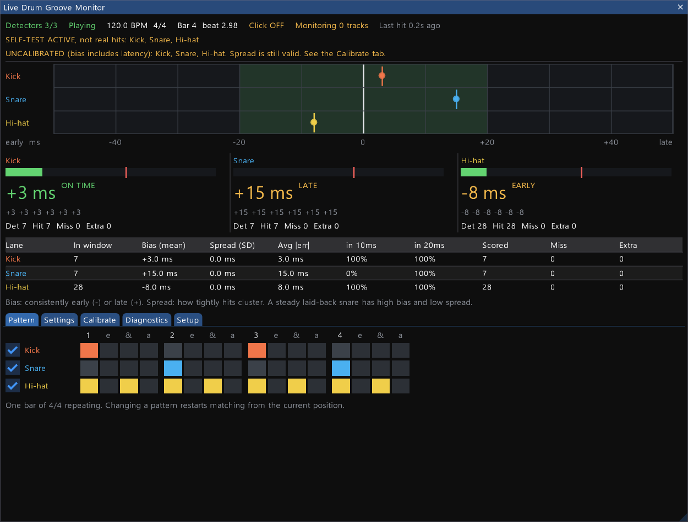
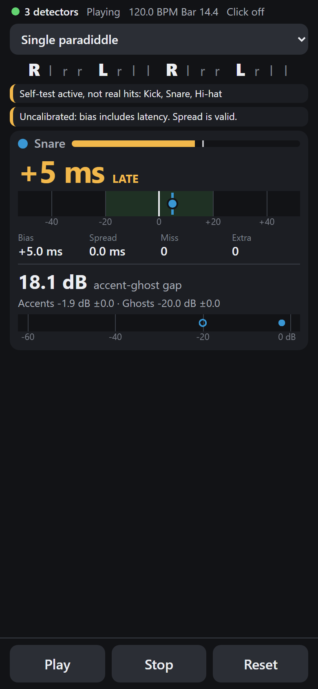

# Live Drum Groove Monitor

See your per-drum timing while you play to REAPER's click, with no recording and no offline analysis. Each hit shows as signed milliseconds, early (`-`) or late (`+`) against what that drum was supposed to play.

It keeps two things separate on purpose. **Bias** is whether a limb sits consistently early or late. **Spread** is how tightly it clusters. A steady laid-back snare has high bias and low spread, and that's a different thing from a snare wandering around zero.



*Screenshot uses the built-in self-test pulses, which is why the spread reads 0.0 ms. Real playing won't.*

## Requirements

- REAPER on Windows (tested on 7.09), with your interface on its ASIO driver
- [ReaPack](https://reapack.com) and the ReaImGui extension, 0.10 or newer
- No Python, no other runtime

## Install

**1. Install ReaImGui, through ReaPack.** Copying only the DLL isn't enough, because ReaPack also installs a companion file the script needs.

1. Download ReaPack from <https://reapack.com> and put its DLL in `%APPDATA%\REAPER\UserPlugins`. Restart REAPER.
2. Extensions > ReaPack > Browse packages. Search `ReaImGui`, right-click it, Install, then Apply. Restart REAPER.

**2. Install this tool.** With REAPER closed, from this folder:

```powershell
powershell -ExecutionPolicy Bypass -File tools\install.ps1
```

Or copy by hand:

| From | To |
|---|---|
| `lua\*.lua` | `%APPDATA%\REAPER\Scripts\LiveDrumGrooveMonitor\` |
| `jsfx\Live Drum Onset Detector.jsfx` | `%APPDATA%\REAPER\Effects\LiveDrumGrooveMonitor\` |

**3. Add the action.** Actions > Show action list > New action > Load ReaScript, then pick `Scripts\LiveDrumGrooveMonitor\Live Drum Groove Monitor.lua`. Run it. Bind it to a key or toolbar button if you like.

## Set up your mics

Each drum gets its own track, with one mono input and one detector. [examples/three-mic-setup.md](examples/three-mic-setup.md) walks through it.

**Quick way:** open the dashboard's Setup tab and click **Add Kick, Snare, Hi-hat tracks**. It asks first, appends three new tracks on inputs 1-3, and changes nothing else. Ctrl+Z removes them. Check that the inputs match your interface.

**By hand**, for each drum:

1. Add a track and set its record input to that mic's **mono** channel.
2. Add `JS: Live Drum Onset Detector` as the **first** FX and set **Lane ID**: 1 = Kick, 2 = Snare, 3 = Hi-hat, up to 8.
3. Record-arm the track and turn input monitoring on. To make sure it never records, right-click the record-arm button and choose *Record: disable (input monitoring only)*.

Then in Options > Preferences > Audio > Device, select your **ASIO** driver and enable the inputs you use.

## Use it

1. Turn on the click (the Setup tab has a toggle) and set a constant tempo.
2. Hit each drum and watch its meter on the dashboard. The red tick is the trigger threshold, and the meter flashes amber on a trigger. This works with the transport stopped, so do your sound check here. Adjust thresholds in the Settings tab.
3. Press play and play. No recording needed.

Results appear up to about 100 ms after each note. A note's result is final once its late window closes, so numbers never change after you've seen them.

The top plot is the one to glance at. Each dot is a hit, the tall tick is your bias, the faint bar is +/- one standard deviation, and the green band is your target.

| On screen | Meaning |
|---|---|
| `+14 ms LATE` / `-9 ms EARLY` | The latest scored hit |
| **Bias (mean)** | Your consistent lean, signed. Includes latency until you calibrate |
| **Spread (SD)** | Consistency. Valid even before calibration |
| **Avg \|err\|** | Average distance from the grid |
| **Miss** | Expected note with no hit by the end of its window |
| **Extra** | Onset with no expected note. Bleed and double-trigger suspects are in Diagnostics |
| `--` | No data. Never shown as 0, so silence can't look like perfect timing |

## Patterns: rudiments and your own grooves

Choose a pattern from the **Pattern** tab, or from the picker on the phone page. Loading one resets the session stats, since they describe the old pattern. It never changes your calibration or thresholds. On the dashboard, *Undo load* brings back what you had.

**Built in:**

- **10 rudiments:** single and double stroke rolls, single and triple paradiddles, single stroke four and seven, and five, seven, nine and thirteen stroke rolls.
- **2 grooves:** Rock beat, and Ghost note groove.

Rudiments go on one lane (Snare by default; change it under *Play it on*). The letters are the sticking, as a reading guide. A mic can't tell which hand hit, so nothing checks your sticking. On one mic a paradiddle and a single stroke roll have the same timing, and what sets them apart is where the accents fall.

Flams, drags and triplet-based rudiments like the paradiddle-diddle aren't included, because they don't fit the 16th-note grid.

**Your own:** set up the grid, type a name, and click *Save groove*. Saving under an existing name asks first. Grooves live in `%APPDATA%\REAPER\Data\LiveDrumGrooveMonitor\grooves.lua`, and appear on the phone too.

These are separate from Settings > *Presets*, which save everything, including calibration.

## Accents and ghost notes

Clicking a grid step cycles it: on, accent (`>`), ghost (`g`), off. Rudiments and the Ghost note groove come marked already.

For any lane with marked steps, you get:

| On screen | Meaning |
|---|---|
| **Accent-ghost gap** | How much louder your accents are than your ghosts, in dB. The number to watch |
| **Accent / ghost level** | Average peak of each. Depends on your mic gain, so compare these only within a session |
| **Accent / ghost spread** | How consistent each one is. Lower is steadier |
| **Ghosts missed** | Marked ghosts with no hit. Too many usually means the threshold is above your ghost notes |
| **Clipped** | Hits that reached full scale. Clipped accents read too quiet, so the gap reads too small: turn your gain down |

As a rule of thumb, every 6 dB is about double the signal level at the mic.

**What this measures:** peak level at the mic, not how loud a hit sounds in the room. It's excellent for comparing your own accents and ghosts on one drum, but a dB figure on one drum can't be compared with another drum or mic.

**Three things can skew it:**

- **Missed ghosts aren't in the average.** If your softest ghosts fall below the threshold, the ones left are your louder ones, and the gap reads too small. Keep Ghosts missed at zero by lowering the threshold, then check bleed isn't triggering it.
- **A ghost right after an accent sits on the accent's ring,** so it reads a little loud. In a synthetic test this took 18.1 dB down to 17.3 dB. A dampened snare will be affected less than a ringing one.
- **Bleed can count as a ghost.** Your ghost is the softest thing on that mic, so a kick or hat can be louder at the snare mic than a real ghost. If ghost timing or level looks wrong, try the detection high-pass on the snare's FX window.

If you upgrade from an earlier version, check each existing detector's FX window: *Peak confirm window* should be 5 ms, as tracks you already made keep their old 2 ms, which under-reads low drums. *Re-attack jump* should read 6 dB.

## See it on your phone or tablet

If your kit is in another room, open the results on any device on the same network. The dashboard must stay open on the PC, because that's where the scoring happens. Network delay only affects when you see a result, never the numbers.

1. Run `tools\install.ps1`, which also installs the page, then reopen the dashboard.
2. Turn on REAPER's web interface: Preferences > Control/OSC/Web > Add > Web browser interface. Note the port. It's the same one for any other REAPER web page you already use.
3. On your phone, open `http://<your PC's IP>:<port>/drums.html`. Run `ipconfig` on the PC if you don't know its IP. If it won't connect, allow REAPER through Windows Firewall on private networks.
4. Use your browser's "Add to Home Screen" for an icon of its own.



The page shows each drum's latest offset, a strip of recent hits, bias and spread, the accent-ghost gap where steps are marked, and a pattern picker, plus Play, Stop and Reset. Reset takes two taps, so a stray stick can't wipe your session. Lanes a pattern doesn't use are hidden. Thresholds, calibration and grid editing stay on the PC.

Set your device's screen timeout to something long while you play, because browsers usually can't keep the screen awake on a plain `http` page.

Anyone on your network can open REAPER's web interface unless you give it a username and password in its settings. That applies to this page and any other page it serves.

## Calibrate, or your bias numbers are wrong

Until you calibrate, **every hit reads late by your round-trip latency**, even when it's dead on the click. The click takes time to reach your ears and the mic signal takes time to get back. Lanes show UNCALIBRATED until you deal with this. Spread is unaffected.

- **Quick:** Calibrate tab > *Use for all lanes*, which applies REAPER's reported latency.
- **Accurate:** run the loopback test in [docs/timing-and-calibration.md](docs/timing-and-calibration.md), which measures the real path.

## Limits of this version

- **4/4 at one constant tempo with playrate 1.0 only.** Anything else shows hits but refuses to score, with a banner saying why, rather than giving wrong answers.
- **One bar patterns**, 16 steps.
- **Count-in and pre-roll are untested.** Check them with [the checklist](docs/validation-checklist.md). "Score from bar" lets you ignore lead-in bars.
- A loop that isn't a whole number of bars restarts the pattern at the new position, and early hits just before the wrap count as extras.
- Accuracy depends on your physical setup. Mic distance adds about 0.3 ms per 10 cm, and the detector's timestamps are more precise than the real-world chain. Don't read meaning into sub-millisecond differences.

## Troubleshooting

| Symptom | Check |
|---|---|
| Message says ReaImGui is missing | Install through ReaPack, as above |
| `No detector on this lane` | Add the JSFX and check its Lane ID. Is it installed in `Effects\LiveDrumGrooveMonitor`? |
| `Detector not running` | FX bypassed, or the audio device closed |
| Meter stays dead | Track armed? Monitoring on? Right mono input? Input enabled in Preferences > Audio > Device? |
| `Two detectors share this lane` | Fix a Lane ID. The second instance stands by and can't corrupt data |
| Hits missed | Lower the threshold |
| One hit counts twice | Raise the threshold, lengthen `Retrigger interval`, or raise `Re-attack jump` |
| Ghost notes after accents go missing | Lower the threshold, lower `Re-attack jump`, or try `Detection high-pass` around 1000 Hz |
| Bleed: snare triggers the hat lane | Raise the hat threshold, and use `Detection high-pass` on the hat. Use `Detection low-pass` to reject bleed on the kick |
| Everything reads a steady +N ms | That's latency: calibrate |
| Numbers all look wrong, nothing fits the grid | Project bar lines off? This assumes bar 1 starts at time 0 |

Filters and the finer detector controls are on each track's FX window. They affect detection only: the audio passes through unchanged.

## How it works

A JSFX on each track finds onsets on the audio thread and timestamps them to the sample, then publishes them to shared memory. A Lua script reads them, matches each to the pattern, and draws the dashboard.

- [docs/protocol.md](docs/protocol.md): shared-memory layout
- [docs/timing-and-calibration.md](docs/timing-and-calibration.md): clock model, latency and accuracy
- [docs/validation-checklist.md](docs/validation-checklist.md): what has been tested, and what only a real kit can test

Settings are saved in `%APPDATA%\REAPER\Data\LiveDrumGrooveMonitor\`, as readable Lua tables. They live there and not in the project because they describe your kit, and you'll want them in every project.

## Tests

```powershell
lua tests\run.lua
```

Needs any Lua 5.4 interpreter, for development only. `tools/run_rig.py` runs `tests/reaper_integration.lua` inside an isolated REAPER against the real JSFX. Read its header first, and don't run it while REAPER is open.

## Open questions

- ReaImGui's API is pinned to 0.10 through `require 'imgui' '0.10'`, so later versions should keep working, but only 0.10.0.5 has been run.
- Timestamps use `play_position` on armed, monitored tracks. Real ASIO input hasn't been exercised: see the checklist.
